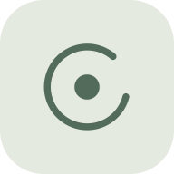
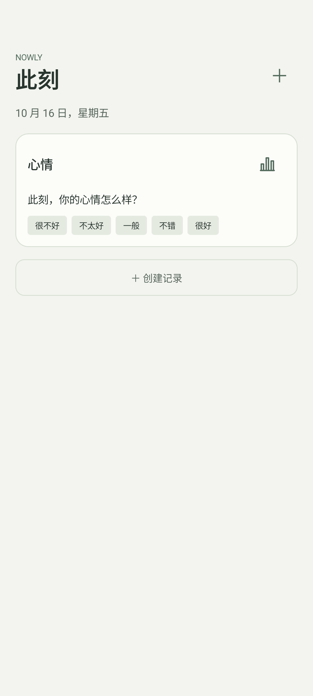
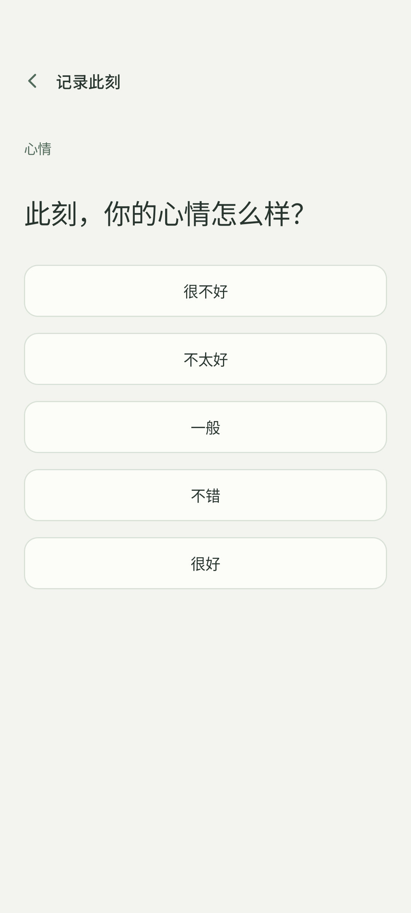
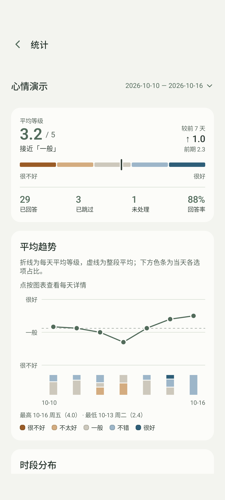

<h1 align="center">此刻 · Nowly</h1>

留意此刻，就够了。

<a href="https://sandykidyao.github.io/nowly/">产品介绍</a> · <a href="https://github.com/SandyKidYao/nowly/releases/latest">下载 Android APK</a>

此刻是一款轻量的日常状态记录 App。在你设定的时间，停下来回答一个小问题，慢慢看见心情、压力或精力的变化。

- **按自己的方式记录**：自定义问题、从低到高的回答选项和每天的提醒时间。
- **轻点一下，回到生活**：选择即保存；不方便时可以跳过，不用补填。
- **看见日常规律**：平均趋势、时段分布与记录色块，帮你回看一段时间的状态。
- **数据由你掌握**：无需账号，离线使用；可导出 CSV，或复制分析提示词到自己选择的 AI 工具。

  
  
  

支持 Android 8.0 及以上。安装后请允许通知；部分手机还需开启自启动和后台运行，见[提醒帮助](docs/background-reminders.md)。卸载或清除应用数据会丢失本地记录，目前不支持导入恢复。

欢迎通过 [Issues](https://github.com/SandyKidYao/nowly/issues) 反馈问题或提出想法。参与开发请阅读[开发文档](docs/README.md)。

[MIT License](LICENSE)
